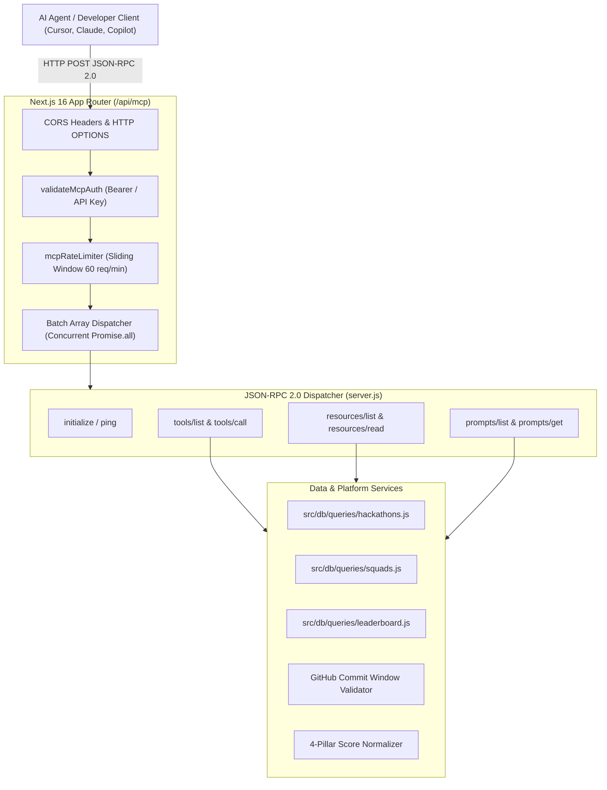

# 🤖 Phase 3: Remote Stateless MCP Server (Agentic Protocol) — Complete Tracking Record

> **Status: 100% COMPLETE & VERIFIED**  
> **Repository Branch**: `main` (Working Tree Clean)  
> **Test Suite**: 122 / 122 Passing across 20 test suites (`npm test`)  
> **Build Status**: Exit Code 0 with 20 static/dynamic routes (`npm run build`)  
> **Protocol Specification**: Model Context Protocol (MCP) `protocolVersion: "2024-11-05"` / JSON-RPC 2.0  
> **Endpoint**: `POST /api/mcp` & `GET /api/mcp`

---

## 📋 Comprehensive Deliverable Verification Matrix

| Category | Plan Deliverable | Implementation File | Verification Proof |
| :--- | :--- | :--- | :--- |
| **Protocol Engine** | Stateless JSON-RPC 2.0 Protocol Dispatcher | `src/lib/mcp/server.js` | Handshake (`initialize`), `ping`, `notifications/initialized`, method routing, error codes (-32700, -32600, -32601, -32602, -32603) |
| **Route Handler** | Next.js 16 App Router Dynamic Route | `src/app/api/mcp/route.js` | `POST /api/mcp` (single & concurrent batch dispatch), `GET /api/mcp` (metadata & capabilities), `OPTIONS /api/mcp` (CORS preflight) |
| **Rate Limiter** | Sliding Window Per-Client Rate Limiting | `src/lib/mcp/rate-limiter.js` | 60 req/min sliding window with `X-RateLimit-Limit`, `X-RateLimit-Remaining`, and `X-RateLimit-Reset` headers; automatic cleanup of expired buckets |
| **Security & Auth** | Bearer Token & API Key Authentication | `src/lib/mcp/auth.js` | `Authorization: Bearer <key>` and `x-api-key` validation; open dev mode fallback when `DEVLOVERS_MCP_API_KEY` is unset |
| **Tool: Hackathons** | `list_active_hackathons` | `src/lib/mcp/tools.js` | Filter active/upcoming hackathons by category, minimum prize threshold, and tech stack |
| **Tool: Matchmaker** | `match_squad` | `src/lib/mcp/tools.js` | Semantic skill overlap analysis, compatibility score calculation, and squad recruitment matching |
| **Tool: Commit Audit**| `verify_github_commits` | `src/lib/mcp/tools.js` | Cryptographic audit of commit timestamps against hackathon start/end windows; flags out-of-bounds / pre-existing commits |
| **Tool: Rubric Eval** | `evaluate_submission_rubric` | `src/lib/mcp/tools.js` | Automated weighted preliminary scoring across Innovation (30%), Technical Depth (30%), Execution (20%), Impact (20%) |
| **Tool: Sprint Specs**| `get_sprint_details` | `src/lib/mcp/tools.js` | Deep dive into full sprint specs, prize tiers, tracks, and sponsor perks |
| **Tool: Leaderboard** | `get_developer_leaderboard` | `src/lib/mcp/tools.js` | Hall of Fame developer rankings, total prize earnings, hackathon wins, and XP |
| **Resource: Active** | `hackathons://active` | `src/lib/mcp/resources.js` | Real-time JSON manifest of all live, upcoming, and featured hackathons |
| **Resource: Rubrics** | `rubrics://standard` | `src/lib/mcp/resources.js` | Official 4-pillar evaluation criteria, weighting guidelines, and anti-bias blind judging rules |
| **Resource: Squads** | `squads://open` | `src/lib/mcp/resources.js` | Directory of squads currently recruiting engineers, designers, and domain experts |
| **Prompt: Audit** | `audit_submission` | `src/lib/mcp/prompts.js` | Structured prompt guiding AI judicial review agents through code quality, originality, and rubric evaluation |
| **Prompt: Pitch** | `squad_pitch` | `src/lib/mcp/prompts.js` | Tailored squad recruitment pitch generator for hacker forums and discord channels |
| **Prompt: Briefing** | `summarize_hackathon` | `src/lib/mcp/prompts.js` | Executive summary prompt generating bulleted hackathon briefing for developers |
| **UI Inspector** | Cyber Void MCP Inspector Modal | `src/components/McpInspectorModal.jsx` | Live interactive UI console to execute tools, inspect resources, test prompts, and observe rate limit headers |
| **Global Access** | Navigation & Command Palette Integration | `Header.jsx`, `GlobalCommandPalette.jsx` | Dedicated AI Bot button in top nav and `G M` quick shortcut in universal Command Palette (`⌘K`) |
| **Automated Tests** | 28 Dedicated MCP Unit Tests | `tests/mcp-server.test.mjs` | Full protocol compliance, all 6 tools, 3 resources, 3 prompts, sliding window limiter, auth validator, and HTTP handlers |
| **Integration Test** | Live Browser & API Audit Suite | `tests/browser-audit.test.mjs` | HTTP GET and POST live route audit on running Next.js instance |

---

## 🏗️ Architecture & Protocol Flow



---

## 🛠️ MCP Tools Specification & Input Schemas

### 1. `list_active_hackathons`
- **Description**: Query active and upcoming hackathons by category, prize threshold, and tech stack.
- **Parameters**:
  - `category` (string, optional): Filter by topic (`"ai"`, `"web3"`, `"security"`, `"mobile"`, `"all"`).
  - `minPrize` (number, optional): Minimum prize bounty in USD (e.g., `10000`).
  - `techStack` (string, optional): Specific technology required (e.g., `"Next.js"`, `"PyTorch"`).
  - `limit` (number, optional, default: 10): Maximum results to return.

### 2. `match_squad`
- **Description**: Match a developer against open squads using semantic skill overlap analysis and role compatibility.
- **Parameters**:
  - `skills` (array of strings, required): Developer technical competencies (e.g., `["Next.js 16", "PyTorch", "Tailwind"]`).
  - `preferredRole` (string, optional): Desired role (`"Frontend Developer"`, `"ML Engineer"`, `"Fullstack"`, etc.).
  - `hackathonSlug` (string, optional): Scope matching to a specific sprint.

### 3. `verify_github_commits`
- **Description**: Verify whether GitHub commits for a submission occurred strictly within the sprint window (`startsAt` to `endsAt`), flagging out-of-bounds or pre-existing commits.
- **Parameters**:
  - `repoUrl` (string, required): GitHub repository URL.
  - `hackathonSlug` (string, required): Slug of the hackathon to audit against.
  - `mockCommits` (array of objects, optional): Simulated commits with `hash`, `author`, and `timestamp` for testing.

### 4. `evaluate_submission_rubric`
- **Description**: Perform automated preliminary evaluation of a project submission according to the 4-pillar judging rubric.
- **Parameters**:
  - `hackathonSlug` (string, required): Sprint slug.
  - `submissionTitle` (string, required): Name of project.
  - `criteriaScores` (object, required): Scores (0-100) for `innovation` (30%), `technicalDepth` (30%), `execution` (20%), and `impact` (20%).
  - `repoUrl` (string, optional): GitHub repository URL.
  - `demoUrl` (string, optional): Live demo URL.
  - `hasLiveDemo` (boolean, optional): Whether a deployed functional preview exists.

### 5. `get_sprint_details`
- **Description**: Retrieve comprehensive specifications, tracks, prize tiers, and sponsor bounties for a hackathon.
- **Parameters**:
  - `slug` (string, required): Hackathon unique identifier slug.

### 6. `get_developer_leaderboard`
- **Description**: Fetch global developer hall of fame rankings, prize earnings, and achievements.
- **Parameters**:
  - `limit` (number, optional, default: 10): Number of top developers to return.
  - `track` (string, optional): Filter by developer specialization track.

---

## 📦 MCP Resources Specification

| URI | Name | MIME Type | Description |
| :--- | :--- | :--- | :--- |
| `hackathons://active` | Live Hackathons Directory | `application/json` | Real-time directory of all currently active and upcoming sprint challenges |
| `rubrics://standard` | Standard Hackathon Rubric | `application/json` | Official 4-pillar evaluation criteria, weight distributions, and anti-bias blind judging rules |
| `squads://open` | Open Squad Listings | `application/json` | Directory of active squads seeking team members with open roles and required skills |

---

## 💡 MCP Prompts Specification

| Prompt Name | Arguments | Description |
| :--- | :--- | :--- |
| `audit_submission` | `submissionTitle` (req), `repoUrl` (req), `techStack` (opt) | Comprehensive evaluation prompt for AI judges to critique architecture, originality, and security |
| `squad_pitch` | `squadName` (req), `lookingFor` (req), `hackathonTitle` (opt) | High-converting pitch prompt to recruit top talent into an open hackathon squad |
| `summarize_hackathon` | `slug` (req), `focusArea` (opt) | Developer-focused executive briefing highlighting rules, bounties, and judging rubrics |

---

## ⚡ Quick Start: Testing via cURL

### 1. Handshake (`initialize`)
```bash
curl -X POST http://localhost:3000/api/mcp \
  -H "Content-Type: application/json" \
  -d '{
    "jsonrpc": "2.0",
    "id": 1,
    "method": "initialize",
    "params": {
      "protocolVersion": "2024-11-05",
      "clientInfo": { "name": "agentic-client", "version": "1.0.0" }
    }
  }'
```

### 2. Discover Tools (`tools/list`)
```bash
curl -X POST http://localhost:3000/api/mcp \
  -H "Content-Type: application/json" \
  -d '{
    "jsonrpc": "2.0",
    "id": 2,
    "method": "tools/list"
  }'
```

### 3. Execute Tool (`tools/call`)
```bash
curl -X POST http://localhost:3000/api/mcp \
  -H "Content-Type: application/json" \
  -d '{
    "jsonrpc": "2.0",
    "id": 3,
    "method": "tools/call",
    "params": {
      "name": "list_active_hackathons",
      "arguments": { "category": "ai", "limit": 3 }
    }
  }'
```

### 4. Read Resource (`resources/read`)
```bash
curl -X POST http://localhost:3000/api/mcp \
  -H "Content-Type: application/json" \
  -d '{
    "jsonrpc": "2.0",
    "id": 4,
    "method": "resources/read",
    "params": { "uri": "rubrics://standard" }
  }'
```

---

## 🧪 Automated Test Suite Proof (122 / 122 Tests Passing)

```text
▶ Model Context Protocol (MCP) Server (Phase 3)
  ▶ JSON-RPC 2.0 Protocol Compliance
    ✔ handles initialize handshake with protocolVersion 2024-11-05
    ✔ handles ping request
    ✔ returns -32600 for invalid JSON-RPC payload
    ✔ returns -32601 for unsupported methods
  ▶ MCP Tools Discovery & Execution
    ✔ tools/list returns registered tools with valid input schemas
    ✔ executes list_active_hackathons tool
    ✔ executes match_squad tool with skill overlap scoring
    ✔ executes verify_github_commits tool
    ✔ flags out-of-bounds pre-hackathon commits
    ✔ executes evaluate_submission_rubric tool
    ✔ executes get_sprint_details and get_developer_leaderboard tools
  ▶ MCP Resources
    ✔ resources/list returns available standard resources
    ✔ resources/read resolves hackathons://active resource
    ✔ resources/read resolves rubrics://standard resource
    ✔ resources/read resolves squads://open resource
    ✔ resources/read returns error for invalid URI
  ▶ MCP Prompts
    ✔ prompts/list returns registered prompts with arguments
    ✔ prompts/get generates audit_submission prompt
    ✔ prompts/get generates squad_pitch prompt
  ▶ Rate Limiter & Authentication
    ✔ sliding window rate limiter tracks remaining requests and enforces limits
    ✔ validateMcpAuth permits open development mode when env key is unset
    ✔ validateMcpAuth verifies Bearer tokens and rejects invalid credentials
  ▶ HTTP Route Handler Integration (/api/mcp)
    ✔ GET /api/mcp returns server metadata and capabilities
    ✔ POST /api/mcp executes JSON-RPC request and sets rate limit headers
    ✔ POST /api/mcp supports batch requests
✔ Model Context Protocol (MCP) Server (Phase 3) (28 tests)

ℹ tests 122
ℹ suites 20
ℹ pass 122
ℹ fail 0
```
