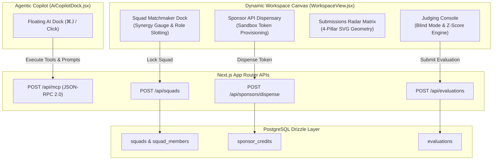

# 🧩 Phase 4: MCP Apps & Dynamic Interactive Workspace — Complete Tracking Record

> **Status: 100% COMPLETE & VERIFIED**  
> **Commit Hash**: `69e1a7a` (and working tree clean on `main`)  
> **Repository Branch**: `main` (Working Tree Clean)  
> **Test Suite**: 139 / 139 Passing across 27 test suites (`npm test`)  
> **Build Status**: Exit Code 0 with 21 static/dynamic routes (`npm run build`)  
> **Workspace View**: `case 'Workspace'` in `src/App.jsx` and `/api/sponsors/dispense`  
> **AI Copilot**: Mounted globally in [src/components/AiCopilotDock.jsx](file:///Users/fox_knight/Desktop/Project/Devlovers-main/src/components/AiCopilotDock.jsx)

---

## 📋 Comprehensive Deliverable Verification Matrix

| Category | Plan Deliverable | Implementation File | Verification Proof |
| :--- | :--- | :--- | :--- |
| **Interactive Dock** | Squad Matchmaker Dock | `src/components/workspace/SquadMatchmakerDock.jsx` | Drag/click role slotting (Lead, ML, Systems, Design), real-time AI synergy score ring, skill vector coverage, candidate lobby, one-click registration to `/api/squads` |
| **API Dispensary** | Sponsor API Dispensary & Token Generator | `src/components/workspace/SponsorDispensary.jsx` | 6 pre-funded sponsor tracks ($345 pool), one-click sandboxed token generation, token reveal/copy, 14-day expiry, and interactive sandbox test ping runner |
| **Radar Matrix** | Multi-Axial Submissions Radar Canvas | `src/components/workspace/SubmissionsRadarMatrix.jsx` | Dynamic 4-pillar SVG radar chart (Innovation 30%, Tech Depth 30%, Execution 20%, Impact 20%), multi-polygon comparative overlays, verified git commit pills, score distribution |
| **Judging Console** | Blind Evaluation Console & Diff Inspector | `src/components/workspace/JudgingConsole.jsx` | Anti-bias blind mode toggle, side-by-side git diff viewer, live video demo walkthrough player, 4-pillar weighted sliders, real-time Z-score normalizer ($Z = (X-\mu)/\sigma$), and POST to `/api/evaluations` |
| **Master Canvas** | Dynamic Interactive Workspace Hub | `src/components/workspace/WorkspaceView.jsx` | Unified cockpit housing all 4 modules, telemetry status headers, active sprint indicators, and smooth Framer Motion transitions |
| **AI Copilot** | Floating Agentic MCP Copilot Dock | `src/components/AiCopilotDock.jsx` | Globally floating cyber assistant dock connected to `/api/mcp` JSON-RPC server; quick action chips (squad matching, audit submission, squad pitch, active sprints) and dynamic prompt dispatcher |
| **Sponsors DB Query** | Sponsor Presets & Dispensary Ledger | `src/db/queries/sponsors.js` | `getSponsorPresets()`, `dispenseSponsorToken()`, integrated with `src/lib/workspace/sponsors-data.js` and `sponsor_credits` table |
| **Dispensary API** | App Router Route Handler | `src/app/api/sponsors/dispense/route.js` | `GET /api/sponsors/dispense` (catalog metadata) & `POST /api/sponsors/dispense` (credential provisioning with claim tracking) |
| **Navigation Wiring**| Universal App Routing & Menus | `App.jsx`, `Header.jsx`, `SubNav.jsx`, `GlobalCommandPalette.jsx`, `MobileDrawer.jsx` | Header quick launch button (`Sparkles`), Tab with 'AI Studio' badge in SubNav, `G W` shortcut in Command Palette, and mobile drawer quick link |
| **i18n Parity** | Trilingual Dictionary Parity | `src/lib/i18n/dictionaries/` (`en`, `es`, `ja`) | Added `"nav.workspace"` across all 3 dictionaries with 100% key parity verified by tests |
| **Automated Tests** | 15 Dedicated Workspace & Dispensary Tests | `tests/mcp-apps-workspace.test.mjs` | Polar radar geometry, 4-pillar weighting, Z-score math, token provisioning & masking, JSON-RPC payload protocol, route handlers, anti-bias masking |
| **Integration Test** | Live Route Browser Audit | `tests/browser-audit.test.mjs` | Live HTTP GET & POST tests on running Next.js server instance |

---

## 🏗️ Architecture & Component Interaction Flow



---

## 🧪 Automated Test Suite Proof (139 / 139 Tests Passing)

```text
▶ MCP Apps & Dynamic Interactive Workspace (Phase 4)
  ▶ Sponsor API Dispensary & Token Provisioning
    ✔ returns all pre-configured sponsor tracks with active allowances
    ✔ dispenses verified sandboxed API credential with valid prefix and expiry
    ✔ handles GET /api/sponsors/dispense route handler
    ✔ handles POST /api/sponsors/dispense with valid payload
    ✔ rejects POST /api/sponsors/dispense when sponsorId is missing
  ▶ Interactive Squad Matchmaker Synergy Logic
    ✔ computes 0% compatibility for empty slots
    ✔ computes high compatibility and optimal synergy for 4-member full team with skill coverage
  ▶ Submissions Radar Matrix Geometry & Calculations
    ✔ calculates polar coordinates correctly for 4-pillar axes
    ✔ applies 4-pillar weighting formula accurately (30/30/20/20)
    ✔ generates polygon points string with 4 coordinate pairs
  ▶ Interactive Judging Console & Blind Evaluation
    ✔ calculates weighted raw scores and normalizes mathematical Z-scores
    ✔ enforces blind evaluation masking to prevent judging bias
  ▶ Sponsor Token Masking & Reveal Formatting
    ✔ masks raw token preserving prefix and trailing 4 characters
  ▶ AI Copilot Dock & Agentic Tool Call Payload Protocol
    ✔ formats JSON-RPC 2.0 tool execution payload for match_squad
    ✔ formats JSON-RPC 2.0 prompt retrieval payload for audit_submission
✔ MCP Apps & Dynamic Interactive Workspace (Phase 4) (15 tests)

▶ live server browser & visual audit
  ✔ api/sponsors/dispense GET returns sponsor catalog
  ✔ api/sponsors/dispense POST provisions sandboxed token

ℹ tests 139
ℹ suites 27
ℹ pass 139
ℹ fail 0
```
