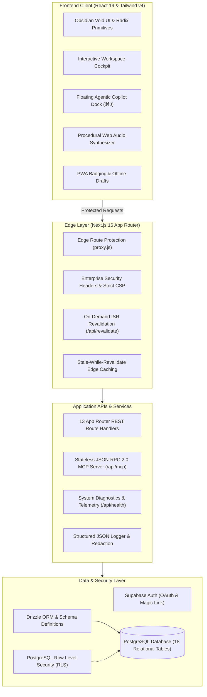

<div align="center">

# 🌌 DEVLOVERS

### **The Global Hackathon & Developer Innovation Platform**

*Empowering developers worldwide with high-stakes hackathons, dynamic squad formation, autonomous AI agent tooling, and anti-bias algorithmic judging.*

[](https://github.com/FOX-KNIGHT/Devlovers/actions)
[](https://nextjs.org/)
[](https://react.dev/)
[](https://tailwindcss.com/)
[](https://orm.drizzle.team/)
[](https://modelcontextprotocol.io/)
[](tests/)
[](LICENSE)

[**Explore Features**](#-core-features) • [**Architecture**](#-architecture) • [**Agentic MCP Server**](#-model-context-protocol-mcp) • [**Quickstart**](#-quickstart) • [**API Reference**](#-api-directory) • [**Shortcuts**](#-keyboard-navigation)

</div>

---

## 📖 Executive Summary

**Devlovers** is a full-stack, enterprise-grade hackathon ecosystem built for modern developers, engineering teams, and autonomous AI agents. Combining high-performance web engineering (**Next.js 16 App Router**, **React 19**, and **Tailwind CSS v4**) with an agentic **Model Context Protocol (MCP)** server, Devlovers transforms traditional competitive programming into an intelligent, collaborative workspace.

From AI-powered squad matchmaking and instant sandboxed sponsor API provisioning to mathematical Z-Score anti-bias evaluation and procedural audio feedback, Devlovers delivers a friction-free experience for organizers, participants, and judicial review boards.

---

## ⚡ Core Features

### 🚀 1. Dynamic Hackathon Sprints & Feed
- **Live Telemetry & Countdown Timers**: Real-time ticker tracking sprint start/end times with localized countdown clocks.
- **Multi-Pillar Rubric Breakdown**: Transparent 100% weighted judging criteria (Innovation 30%, Tech Depth 30%, Execution 20%, Impact 20%) displayed directly on challenge cards.
- **Omni-Filter & Tech Stack Matching**: Filter active sprints by track (AI, Web3, Systems, Cloud, Mobile), bounty threshold, and active tech stack tags.
- **Global FX & Dual-Timezone Engine**: Instant on-the-fly prize currency conversion (USD, EUR, GBP, INR, JPY) and one-click toggle between Local Browser Time and UTC.

### 🤝 2. Intelligent Squad Matchmaker Dock
- **AI Synergy Gauge**: Real-time calculated compatibility ring measuring cross-functional balance and skill vector overlaps.
- **Role Slotting System**: Interactive position slotting for Squad Lead, ML Engineer, Systems Architect, and Product Designer.
- **Candidate Lobby**: Search and recruit vetted developers by specialty, GitHub profile, and past hackathon wins.
- **Offline Draft Persistence**: Robust LocalStorage serialization ensuring squad pitches and registrations survive browser restarts or network disruptions.

### 💳 3. Sponsor API Dispensary
- **Pre-Funded Credit Pool ($345)**: Integrated sponsor tracks including Google Cloud, Anthropic, Supabase, Neon, Resend, and Vercel.
- **Sandboxed Credential Generation**: One-click provisioning of sandboxed developer API tokens with automated 14-day expiry and usage tracking.
- **In-Browser Sandbox Ping**: Test endpoints live directly inside the UI before writing a line of code.

### 🎯 4. Multi-Axial Submissions Radar Matrix
- **Dynamic 4-Pillar SVG Geometry**: Interactive polar radar visualization comparing project score metrics across Innovation, Tech Depth, Execution, and Impact.
- **Verified GitHub Commits**: Automated inspection validating that repository commits occurred strictly within the sprint window.
- **Submission Showcase**: Community project gallery with live demo links, repository badges, and threaded peer reviews.

### ⚖️ 5. Blind Anti-Bias Judging Console
- **Double-Blind Review**: Anonymizes squad names, avatars, and institutional affiliations to guarantee impartial grading.
- **Side-by-Side Git Diff Viewer**: Inspect candidate pull requests and commits alongside embedded video walkthrough demonstrations.
- **Mathematical Z-Score Normalization**: Automatically normalizes scores using standard deviation calculations ($Z = \frac{X - \mu}{\sigma}$) to neutralize lenient or strict judge biases.

### 🤖 6. Autonomous Agentic AI Copilot & MCP Server
- **Floating Copilot Dock (`⌘J`)**: Global agent interface connected directly to the backend JSON-RPC server for squad matchmaking, sprint summaries, and rubric auditing.
- **Stateless MCP Server (`POST /api/mcp`)**: Native support for Anthropic Claude, Google Gemini, and autonomous AI agents through standard Model Context Protocol.

---

## 🏗️ Architecture



---

## 🤖 Model Context Protocol (MCP)

Devlovers exposes a production-grade, stateless **Model Context Protocol (MCP)** server adhering strictly to the MCP specification (`protocolVersion: "2024-11-05"`). AI agents can connect via standard JSON-RPC 2.0 at `POST /api/mcp`.

### 🛠️ Available MCP Tools

| Tool Name | Parameters | Purpose |
| :--- | :--- | :--- |
| `list_active_hackathons` | `category`, `min_prize_cents`, `status`, `tech_stack` | Query active sprints with prize, track, and stack filters. |
| `match_squad` | `skills` *(array)*, `experience_level`, `preferred_track` | Compute semantic squad matches based on developer skill vectors. |
| `verify_github_commits` | `repo_url`, `starts_at`, `ends_at` | Audit commit timestamps against the official hackathon sprint window. |
| `evaluate_submission_rubric` | `submission_id`, `repo_url`, `demo_url` | Run preliminary automated 4-pillar scoring with compliance checks. |
| `get_sprint_details` | `slug` | Fetch complete specifications, prize tiers, tracks, and sponsor perks. |
| `get_developer_leaderboard` | `limit`, `sort_by` | Retrieve developer rankings, podium badges, XP, and bounties won. |

### 📂 MCP Resources & Prompts

- **Resources**:
  - `hackathons://active` — Live JSON feed of active and upcoming hackathons.
  - `rubrics://standard` — Standard 4-pillar evaluation criteria and judging rubric rules.
  - `squads://open` — Roster of active squads seeking team members.
- **Prompts**:
  - `audit_submission` — Judicial evaluation framework for AI scoring agents.
  - `squad_pitch` — Automated ideation and team pitch generator.
  - `summarize_hackathon` — Concise executive briefing on rules, bounties, and deadlines.

---

## 💻 Tech Stack

| Domain | Technology | Description |
| :--- | :--- | :--- |
| **Framework** | [Next.js 16.4.6](https://nextjs.org/) | App Router, Server Actions, Server Components, `next/og` generation |
| **UI Library** | [React 19.2.0](https://react.dev/) | Concurrent rendering, Server Actions, transitions |
| **Styling** | [Tailwind CSS v4.3.5](https://tailwindcss.com/) | Pure CSS `@import "tailwindcss";`, `@property` conic animations |
| **Primitives** | [Radix UI](https://www.radix-ui.com/) | Accessible dialogs, popovers, slots, and focus traps |
| **Animations** | [Framer Motion 14.14](https://www.framer.com/motion/) | 3D card tilt & glare physics, spring tabs, popLayout feeds |
| **Audio Engine** | Web Audio API | Zero-asset synthesized oscillator clicks and success chimes |
| **Database** | [PostgreSQL](https://www.postgresql.org/) | 18 relational tables, 4 native enums, foreign key cascading |
| **ORM** | [Drizzle ORM 0.45.4](https://orm.drizzle.team/) | Type-safe schema definitions, relational queries, Drizzle Kit |
| **Auth & Security** | [Supabase](https://supabase.com/) | `@supabase/ssr`, OAuth (GitHub & Google), Magic Link, Postgres RLS |
| **Agent Protocol** | [MCP Protocol](https://modelcontextprotocol.io/) | Stateless JSON-RPC 2.0 server at `/api/mcp` |
| **Testing** | Node 20 Native `node:test` | Zero-dependency testing with 155 automated tests across 34 suites |
| **Observability** | Structured Logger & RUM | JSON format, token redaction, Core Web Vitals, OpenTelemetry stubs |

---

## 🚀 Quickstart

### Prerequisites

- **Node.js**: `20.x` or `22.x` LTS
- **npm**: `10.x` or higher
- *(Optional)* **PostgreSQL** or a free [Supabase](https://supabase.com) project (the platform includes built-in offline fallbacks if a database is not connected).

### 1. Clone the Repository
```bash
git clone https://github.com/FOX-KNIGHT/Devlovers.git
cd Devlovers
```

### 2. Install Dependencies
```bash
npm install
```

### 3. Configure Environment Variables
Create your local environment file:
```bash
cp .env.example .env.local
```
*(Optionally populate your `DATABASE_URL` and `NEXT_PUBLIC_SUPABASE_*` credentials. If left blank, Devlovers seamlessly boots with realistic in-memory mock datasets).*

### 4. (Optional) Run Database Migrations & Seed
If running a live PostgreSQL instance:
```bash
# Generate SQL migrations
npm run db:generate

# Apply migrations to PostgreSQL
npm run db:migrate

# Seed realistic hackathons, squads, and users
npm run db:seed
```

### 5. Launch the Development Server
```bash
npm run dev
```
Open **[http://localhost:3000](http://localhost:3000)** in your browser.

---

## 🧪 Testing & Code Quality

Devlovers features a high-speed, zero-dependency test suite built on Node's native `node:test` and `node:assert/strict`:

```bash
# Execute full test suite (155 tests across 34 suites)
npm test

# Run ESLint 10 code quality check
npm run lint

# Build production bundle
npm run build
```

### Test Suite Coverage Breakdown

```
✔ PWA Badging API (4 tests)
✔ Live Server Browser & Visual Audit (24 tests)
✔ Countdown Timer Math & Edge Cases (4 tests)
✔ Mock Data Schema Contract (7 tests)
✔ Database Query Repositories (17 tests)
✔ Drizzle ORM Schema Tables & Enums (5 tests)
✔ Currency & Date Formatters (8 tests)
✔ Multi-Language i18n Dictionary Parity (3 tests)
✔ MCP Apps & Interactive Workspace (15 tests)
✔ Model Context Protocol JSON-RPC Server (23 tests)
✔ Offline LocalStorage Draft Persistence (4 tests)
✔ Production Hardening & Observability (16 tests)
✔ Supabase Auth & Row Level Security (18 tests)
✔ ...
─────────────────────────────────────────────────────────────
TOTAL: 155 Passing  |  0 Failing  |  Execution: ~650ms
```

---

## 📁 Project Directory Structure

```text
devlovers-platform/
├── .github/
│   ├── dependabot.yml           # Automated dependency scanning
│   └── workflows/ci.yml         # Multi-stage CI/CD workflow
├── drizzle/                     # Drizzle Kit SQL migrations (0000 - 0004)
├── public/                      # Static assets, PWA manifest.json
├── src/
│   ├── app/                     # Next.js 16 App Router
│   │   ├── api/                 # 13 REST & JSON-RPC API Route Handlers
│   │   │   ├── hackathons/      # Sprint querying & retrieval
│   │   │   ├── health/          # System uptime & telemetry probe
│   │   │   ├── mcp/             # Stateless Model Context Protocol endpoint
│   │   │   ├── revalidate/      # On-demand ISR cache tag & path purge
│   │   │   ├── sponsors/        # Sponsor API token dispensary
│   │   │   └── squads/          # Squad creation & matchmaking
│   │   ├── auth/                # Supabase OAuth callback & confirm handlers
│   │   ├── globals.css          # Tailwind CSS v4 & Obsidian Void tokens
│   │   ├── layout.jsx           # Root layout with providers & telemetry
│   │   ├── opengraph-image.jsx  # Dynamic edge social preview generation
│   │   └── page.jsx             # Root server component
│   ├── components/              # Radix & Framer Motion UI Components
│   │   ├── workspace/           # Workspace cockpit (Matchmaker, Dispensary, Radar, Judging)
│   │   ├── AiCopilotDock.jsx    # Floating MCP agentic assistant
│   │   ├── GlobalCommandPalette.jsx # Universal ⌘K navigation
│   │   ├── LeaderboardView.jsx  # Global developer rankings & podium
│   │   └── MobileDrawer.jsx     # Responsive slide-out navigation sheet
│   ├── db/                      # High-Performance Data Layer
│   │   ├── schema/              # 18 Relational tables, enums, & relations
│   │   ├── queries/             # 10 Type-safe query repositories
│   │   ├── client.js            # Hybrid PostgreSQL / Offline mock client
│   │   ├── migrate.js           # Programmatic migration runner
│   │   └── seed.js              # Comprehensive dataset seeder
│   └── lib/                     # Core Business Logic & Infrastructure
│       ├── audio/               # Web Audio API procedural synthesizer
│       ├── i18n/                # Multi-language dictionary engine (EN, ES, JA)
│       ├── mcp/                 # MCP JSON-RPC protocol parser, tools, & prompts
│       ├── observability/       # Structured JSON logger, telemetry, & web vitals
│       ├── pwa/                 # App Badging API native synchronization
│       ├── storage/             # Resilient LocalStorage draft serializer
│       └── supabase/            # Browser & server Supabase client singletons
├── tests/                       # 34 Test suites covering platform contracts
├── drizzle.config.js            # Drizzle Kit configuration
├── next.config.mjs              # Next.js 16 configuration with strict CSP
├── package.json                 # Pure ESM dependencies & scripts
└── vercel.json                  # Multi-region global edge deployment spec
```

---

## ⌨️ Keyboard Navigation

Devlovers is designed with keyboard-first accessibility across every view:

| Shortcut | Action | Scope |
| :--- | :--- | :--- |
| <kbd>⌘K</kbd> / <kbd>Ctrl+K</kbd> | Open Universal Command Palette | Global |
| <kbd>⌘J</kbd> / <kbd>Ctrl+J</kbd> | Toggle Floating AI Copilot Dock | Global |
| <kbd>G</kbd> <kbd>W</kbd> | Navigate to Interactive AI Workspace | Global |
| <kbd>G</kbd> <kbd>M</kbd> | Open MCP Protocol & Inspector Modal | Global |
| <kbd>ESC</kbd> | Dismiss active modal, popover, or drawer | Global |

---

## 🌐 API Directory

| Endpoint | Method | Description |
| :--- | :--- | :--- |
| `/api/mcp` | `POST` | Model Context Protocol JSON-RPC 2.0 dispatcher. |
| `/api/mcp` | `GET` | Retrieve MCP server capabilities, protocol version, and manifest. |
| `/api/health` | `GET`, `HEAD` | System diagnostic probe reporting memory, database status, and uptime. |
| `/api/revalidate` | `POST` | On-demand ISR cache purge for specific paths or tags. |
| `/api/sponsors/dispense`| `GET`, `POST` | Catalog query & token provisioning for sponsor credits. |
| `/api/hackathons` | `GET`, `POST` | Query active sprints or register new hackathons. |
| `/api/squads` | `GET`, `POST` | Squad listings, role requirements, and squad formation. |
| `/api/submissions` | `GET`, `POST` | Retrieve showcase projects and submit hackathon drafts. |
| `/api/evaluations` | `POST` | Submit judicial scores with automatic Z-Score normalization. |
| `/api/leaderboard` | `GET` | Global developer hall of fame rankings and XP ledger. |
| `/api/notifications` | `GET`, `PATCH`| Notification inbox and read status updates. |

---

## 🔒 Enterprise Security & Compliance

- **Content Security Policy (CSP)**: Strict non-bypassable directives (`default-src 'self'`, `object-src 'none'`, `frame-ancestors 'none'`).
- **HTTP Strict Transport Security (HSTS)**: `max-age=63072000; includeSubDomains; preload`.
- **Database Row Level Security (RLS)**: Enforced across all 18 PostgreSQL tables (`drizzle/0004_rls_policies.sql`).
- **Sanitized Logging**: Automated recursive redaction of sensitive credentials (`token`, `password`, `key`, `secret`) via `logger.js`.
- **Rate Limiting**: Sliding-window limiter on MCP endpoints (60 req/min) to prevent abuse.

---

## 🤝 Contributing

Contributions make the open-source community an inspiring place to learn, inspire, and create. Any contributions you make are **greatly appreciated**.

1. Fork the Project
2. Create your Feature Branch (`git checkout -b feature/AmazingFeature`)
3. Commit your Changes (`git commit -m 'feat: Add some AmazingFeature'`)
4. Verify Tests Pass (`npm test && npm run lint`)
5. Push to the Branch (`git push origin feature/AmazingFeature`)
6. Open a Pull Request

---

## 📜 License

Distributed under the **MIT License**. See [`LICENSE`](LICENSE) for more information.

---

<div align="center">
  <sub>Crafted with passion for the global hacker community. Built with Next.js 16, React 19, and the Model Context Protocol.</sub>
</div>
